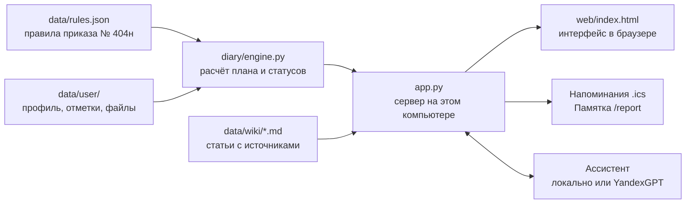

# Дневник здоровья пациента

**За 2 минуты узнайте, какие обследования вам положены бесплатно, и запишитесь в один клик.**

Прототип цифрового сервиса персонального дневника здоровья: профиль пациента, персональный план профилактики по нормативам РФ (приказ Минздрава № 404н), календарь обследований со статусами, учёт пройденных обследований, база знаний «Здоровье / Wiki» и AI-ассистент.

Проект хакатона.

## Проблема → решение

**Проблема.** Каждому взрослому по полису ОМС бесплатно положены профилактический осмотр и диспансеризация, а после 40 лет ещё и онкоскрининги по возрасту. О диспансеризации знают почти все, но мало кто ей доверяет. Люди не видят, что именно им положено по возрасту и полу и что им реально сделали, поэтому считают её «галочкой» и откладывают обследования.

- По опросу ВЦИОМ 2023 года о бесплатной диспансеризации знают **96%**, а доверяют ей только **19%** (в 2021 году было 40%). **64%** считают её формальностью, **28%** никогда её не проходили ([ВЦИОМ](https://wciom.ru/analytical-reviews/analiticheskii-obzor/dispanserizacija-monitoring)).
- Среди работающих не проходили диспансеризацию **43%** ([ВЦИОМ, 2025](https://wciom.ru/analytical-reviews/analiticheskii-obzor/dispanserizacija-dlja-vsekh-prizrak-ili-realnost)).
- По данным Минздрава, в 2025 году профосмотры и диспансеризацию прошли более 104 млн человек, из них 25 млн детей ([Гарант, обзор итогов 2025 года](https://www.garant.ru/article/2084653/)).
- Счётная палата насчитала 87,7 млн человек и **снижение охвата на 10,2%** по сравнению с 2024 годом (там же).
- Порядок сложный: больше десятка обследований, у каждого свой возраст и периодичность, правила меняются (например, анализ на гепатит C добавлен только в 2024 году приказом № 378н).

**Решение.** Личный дневник, который сам считает план по приказу Минздрава № 404н:

| Боль пациента | Что делает дневник |
| --- | --- |
| «Не вижу, что мне положено» | План по дате рождения и полу, у каждого пункта ссылка на пункт приказа |
| «Не помню, когда проходил» | Статус «нет данных» вместо пугающего «просрочено»: пройти при ближайшем визите или указать дату |
| «Забываю» | Напоминания на главной и файл для календаря телефона |
| «Не знаю, что сказать врачу» | Памятка для терапевта: что положено и готовые фразы |
| «Не понимаю, зачем это» | Wiki со статьями и ссылками на официальные источники, ассистент с проверкой источников |
| «Боюсь за свои данные» | Всё хранится на компьютере пациента, согласие по 152-ФЗ, выгрузка и удаление в один клик |

**Быстрый старт:** установите Python 3.9+ с [python.org](https://www.python.org/downloads/), скачайте проект (Code → Download ZIP), распакуйте и дважды щёлкните `start_windows.bat` (Windows) или `start_mac.command` (Mac). Дневник откроется в браузере.

## Что уже работает

**Движок персонального плана** (`diary/engine.py`). По дате рождения, полу и истории обследований он строит план профилактики, считает сроки и ставит статус каждому мероприятию: «актуально», «скоро необходимо пройти» (срок в ближайшие 60 дней), «просрочено» (обследование проходили, и срок следующего прошёл) или «нет данных» (отметок нет: пройти при ближайшем визите, без необоснованного «просрочено»).

- Все правила лежат в одном файле `data/rules.json`: обследование, кому, как часто, пункт приказа Минздрава № 404н и ссылка на текст. Нейросеть в расчёте плана не участвует.
- Если обследование пропущено, оно назначается сразу, а следующий срок отсчитывается от новой даты (как в п. 17 приказа).
- Возраст считается по календарному году, как в приказе: «годом прохождения … считается календарный год, в котором гражданин достигает соответствующего возраста». ПСА и ЭГДС в 45 лет можно сдать в любой день этого года.
- Профосмотр входит в диспансеризацию: в год диспансеризации отдельной задачей он не показывается.
- КТ органов грудной клетки засчитывается вместо флюорографии, КТ молочных желёз — вместо маммографии (на 12 месяцев).
- Анализ на гепатит C учитывается с 30.08.2024, когда его добавил приказ № 378н.
- При отметке диспансеризации можно сразу отметить входящие в неё обследования; любую запись можно исправить.
- Неполные данные: без даты рождения план не строится, и сервис объясняет почему. Без пола показываются только общие обследования и просьба указать пол. Даты из будущего не учитываются.

**Веб-интерфейс** (`app.py`, `web/index.html`):
- главная с итогами и списком «Что сделать в первую очередь»;
- «Мой план» с основанием каждого пункта (ссылка на приказ);
- календарь на 12 месяцев;
- отметка пройденного обследования с датой, результатом и файлом (PDF или фото);
- профиль и переключение демо-пациентов.

**База знаний «Здоровье / Wiki»** (`data/wiki/`): 16 статей простым языком об ОМС, правах пациента, диспансеризации, каждом обследовании из плана и факторах риска. У каждой статьи есть ссылки на источники (приказ № 404н, закон об ОМС, Трудовой кодекс, Госуслуги, Программа госгарантий). Есть поиск, а кнопка «Зачем это?» в плане открывает статью о нужном обследовании. Статьи — обычные текстовые файлы, их можно править без программирования.

**AI-ассистент** (`diary/assistant.py`, AIbert): отвечает на вопросы вроде «Что мне нужно пройти в этом году?», «Какие обследования просрочены?», «Зачем нужно это обследование?», всегда со ссылками на источники.
- Без ключа работает **локально**: ответ собирается из плана и статей Wiki, интернет не нужен.
- С ключом YandexGPT модель получает только пронумерованные фрагменты плана и статей. Ответ принимается, только если в нём есть ссылки на эти фрагменты; иначе показывается локальный ответ.
- В облако не отправляются имя и дата рождения, только возраст, пол и пункты плана. Все запросы пишутся в журнал `data/user/llm_log.jsonl`.

Чтобы включить YandexGPT, создайте в корне проекта файл `.env` (он не попадает в репозиторий):

```
YANDEX_API_KEY=ваш_ключ
YANDEX_FOLDER_ID=идентификатор_каталога
```

Файл, сохранённый Блокнотом как `.env.txt`, тоже подойдёт. При запуске `python app.py` сервис пишет в консоли, нашёл ли он ключ, а если нет, то почему. То же объяснение есть в окне AIbert, в строке «Режим» внизу.

Данные сохраняются в папке `data/user/` и не теряются при перезапуске.

## Прививки

В «Моём плане» есть блок «Прививки» по национальному календарю (приказ Минздрава № 1122н, приложение 1). Всем взрослым — от дифтерии и столбняка раз в 10 лет; от гриппа ежегодно — после 60 лет или если в профиле отмечено «Мне положена ежегодная прививка от гриппа» (беременность, хронические болезни, некоторые профессии). Прививки от гепатита B, кори и краснухи показываются как «если не прививались»: нужны ли они, решает врач по медкарте, поэтому в напоминания и календарь они не попадают. Нормы лежат в `data/rules.json` в разделе `vaccines`.

## Солнце здоровья

На экране «Сегодня» вместо полоски прогресса — солнце. Каждый луч — положенное сейчас обследование, обязательная прививка или шаг профиля (дата рождения и пол, курение, давление за последний год). Луч загорается, когда шаг сделан; серый луч можно нажать, и откроется то, где его зажечь. Рядом — один главный шаг: что сделать сейчас, чтобы зажечь больше всего лучей. Когда горят все лучи, солнце светится (демо-пациентка Мария).

## Дизайн и AIbert

Четыре раздела: «Сегодня» (солнце и один главный шаг), «План» (список или календарь, строка раскрывается на месте), «Дневник» (пройденное и показатели), «Справка». На компьютере меню слева, на телефоне панель снизу. В центре панели — AIbert: ассистент в виде нарисованного доктора (игра слов: Альберт и AI). Он открывается поверх любого экрана, отвечает по плану пациента со ссылкой на источник и не ставит диагнозы.

Палитра «Рассвет»: светлое утреннее небо, тёплое солнце, спокойный синий для кнопок. Есть тёмная тема и «Крупный шрифт» (в профиле). Демо-пациенты и дата расчёта — в «Режиме показа», а не в шапке: так их не загрузить случайно поверх своих данных. Анимации короткие и отключаются, если в системе включено «уменьшить движение».

Шрифты Golos Text и Unbounded лежат в `web/fonts/` (лицензия SIL Open Font License, тексты лицензий там же), поэтому страница не обращается к Google и работает без интернета.

## От плана до поликлиники

- **Запись.** У главного шага и у каждого пункта, который пора пройти, есть кнопка «Записаться на Госуслугах»: для диспансеризации и профосмотра она ведёт на отдельную услугу записи, для остального — на запись к врачу. В профиле можно указать «Мою поликлинику» (название, адрес, телефон): они показываются рядом с кнопкой, телефон нажимается.
- **Онбординг без пустого плана.** Третий вопрос: «Когда вы последний раз проходили диспансеризацию?» (месяц и год, «Не помню» или «Никогда»). Если дата указана, она сохраняется с пометкой «Примерная дата, со слов», и план сразу показывает, пора ли её повторить.
- **Второй этап.** При отметке диспансеризации есть галочка «Врач направил на второй этап». Пока второй этап не отмечен пройденным, он остаётся главным шагом на «Сегодня».
- **AIbert без интернета.** 20 частых вопросов с проверенными ответами и источниками лежат в `data/faq.json`: бесплатно ли, сколько длится, выходной на работе, не по прописке, если отказали и т. д. На них AIbert отвечает этим текстом даже в режиме YandexGPT. Если ответа нет, он предлагает три похожих вопроса.

## Как подготовиться

У каждого пункта плана кнопка «Как подготовиться»: что сделать до визита (например, натощак, без дезодоранта перед маммографией) и что взять с собой. В памятке для терапевта — то же для всего, что пора пройти, и общий список «Взять с собой» без повторов. Тексты — общие рекомендации в `data/preparation.json`, их проверяет медик команды.

## Если отказали или ошибка в выписке ОМС

- **«Отказали в поликлинике?»** — ссылка у пунктов, которые пора пройти. Пациент выбирает, что произошло, дату и кому писать (главному врачу или в страховую), и получает готовый текст заявления со ссылкой на пункт приказа и закон об ОМС. Его можно скопировать или распечатать.
- **«Мои права по ОМС: проверьте выписку»** — в «Дневнике», раздел «Пройдено». Ссылка на выписку «Сведения об оказанных медицинских услугах» на Госуслугах и кнопка «В выписке есть то, чего я не проходил(а)». Такая запись не учитывается в плане, а обращение в страховую составляется одной кнопкой.
- ФИО и номер полиса в заявления не подставляются: пациент вписывает их сам. Тексты заявлений нигде не сохраняются и в нейросеть не отправляются.

## Показатели здоровья

Вкладка «Показатели»: давление, вес, общий холестерин и сахар натощак. Пациент вносит их сам, дневник рисует график изменений и отмечает значения выше критериев факторов риска, по которым их оценивают на диспансеризации (давление 140/90, холестерин 5,0 ммоль/л, сахар 6,1 ммоль/л). Повышенные значения попадают в памятку для терапевта вопросом «что с этим делать?». У демо-пациентов Анны и Ивана уже есть примеры измерений.

## Напоминания

На главной странице блок «Напоминания» показывает всё просроченное и то, что нужно пройти в ближайшие 30 дней. Кнопка «Добавить в календарь телефона» скачивает файл `health-diary.ics`. Его можно открыть в Google, Яндекс или Apple Календаре, и все сроки из плана появятся там с напоминанием за неделю и утром в день обследования. Просроченные обследования собираются в одно событие «Записаться в поликлинику» через неделю, потому что их проходят за один визит.

## Памятка для терапевта

Кнопка «Памятка врачу» (на экране «Сегодня» и в «Дневнике») открывает одну страницу для визита в поликлинику: что положено бесплатно по ОМС, что просрочено, что уже пройдено и с каким результатом, и готовые фразы, что сказать врачу. Страницу можно распечатать или сохранить в PDF. Адрес страницы: `/report`.

## Данные пациента и 152-ФЗ

Сведения о здоровье — специальная категория персональных данных (ст. 10 152-ФЗ). В прототипе:

- **Согласие.** Без отдельного согласия на обработку данных о здоровье свой план не строится, доступны только демо-пациенты. Сохраняются версия и дата согласия.
- **Политика обработки персональных данных** — страница `/privacy`, ссылка внизу каждого экрана и рядом с согласием.
- **«Мои данные» в профиле:** скачать всё одним архивом (`/export.zip`: профиль, отметки, файлы, журнал вопросов к нейросети) и отозвать согласие, что сразу удаляет все данные.
- **Нейросеть.** В YandexGPT уходят только возраст, пол и пункты плана. Телефоны, e-mail, номера полиса, СНИЛС и паспорта вырезаются из вопроса до отправки и не попадают в журнал. В окне AIbert это написано.
- **Файлы.** Принимаются только PDF, JPG и PNG. Тип проверяется по содержимому, а не по имени, и расширение при сохранении выставляется по содержимому.
- **Хранение** — только на компьютере пользователя, сервер принимает подключения только с него же (127.0.0.1).
- Для детей план не строится: сервис рассчитан на взрослых с 18 лет.
- **Защита от чужих сайтов.** Изменить или удалить данные можно только со страницы самого дневника: запросы с других сайтов и с чужим адресом в заголовке `Host` отклоняются. Страницы запрещают встраивание в чужие сайты и отправку данных куда-либо, кроме самого дневника; ответы с данными не сохраняются в кэше браузера.
- **Проверка ввода.** Сервер отвечает понятной ошибкой на любые неверные данные и не засчитывает обследования с датой в будущем. Проверки описаны в `tests/test_security.py`.

**Что понадобится для настоящего сервиса:** уведомление Роскомнадзора и ответственный за обработку ПДн; серверы, база и файлы в российском дата-центре (ст. 18 ч. 5 152-ФЗ); 3-й уровень защищённости по Постановлению № 1119 (пока пациентов меньше 100 000) и меры Приказа ФСТЭК № 21; TLS, шифрование, двухфакторный вход, антивирусная проверка файлов; вход и подписание согласия через Госуслуги (ЕСИА); ответ на обращения пациентов в течение 10 рабочих дней.

## Как это устроено



- **Правила отдельно от кода.** Все нормы лежат в `data/rules.json`: кому, с какого возраста, как часто, пункт приказа. Если Минздрав изменит порядок, достаточно поправить этот файл.
- **План считает только движок.** Нейросеть не участвует в расчёте сроков и статусов, она лишь объясняет план, и каждый её ответ проверяется по источникам.
- **Данные не покидают компьютер.** Сервер слушает только адрес 127.0.0.1, база — один файл `data/user/state.json`.
- **Тесты.** `python -m unittest` проверяет движок на демо-пациентах, прививки, солнце, заявления, приписки, API, напоминания, памятку, Wiki и защиту данных.

## Как запустить

Нужен Python 3.9 или новее, больше ничего устанавливать не надо.

Проще всего дважды щёлкнуть `start_windows.bat` (Windows) или `start_mac.command` (Mac): сервер запустится и сам откроет браузер. Вручную:

```
python app.py --open
```

Адрес: http://127.0.0.1:8000. При первом запуске сервис предлагает ввести дату рождения и пол или посмотреть на примере демо-пациента. Во вкладке «Профиль» можно удалить свои данные и начать заново.

Для демонстрации с фиксированной датой: `python app.py --today 2026-10-24`.

Проверки:

```
python -m unittest -v
python plan.py data/demo/anna.json --today 2026-10-24
```

## Демо-пациенты (`data/demo/`)

| Файл | Кто | Что проверяет |
| --- | --- | --- |
| anna.json | Анна, 41 год | главный сценарий: просроченная диспансеризация, маммография после 40 |
| ivan.json | Иван, 44 года | через месяц 45: появляются ПСА и ЭГДС |
| mariya.json | Мария, 25 лет | всё пройдено, солнце горит целиком |
| petr.json | Пётр, 67 лет | после 65 лет кал на скрытую кровь ежегодно, ПСА уже не положен; прививка от гриппа после 60 лет |
| olga_39.json | Ольга, 39 лет | переход на ежегодную диспансеризацию в 40 лет; маммография не назначается после мастэктомии |
| no_sex.json | без пола | неполные данные: только общие обследования |
| no_birth_date.json | без даты рождения | неполные данные: план не строится, есть объяснение |

## Помощь при разработке с Claude Code (`.claude/`)

- **Автоматические тесты.** После каждой правки кода, правил или тестов Claude сам запускает `python -m unittest` и сразу видит, если что-то сломалось (`.claude/settings.json`, `.claude/hooks/run_tests.py`).
- **`/check-norm`** — сверить правило из `data/rules.json` с текстом приказа и обновить дату проверки в Wiki.
- **`/demo-run`** — прогон перед защитой: демо-пациенты в браузере на компьютере и телефоне, скриншоты.
- **Проверяющий `med-legal-reviewer`** — ищет медицинские и юридические неточности в текстах для пациента.
